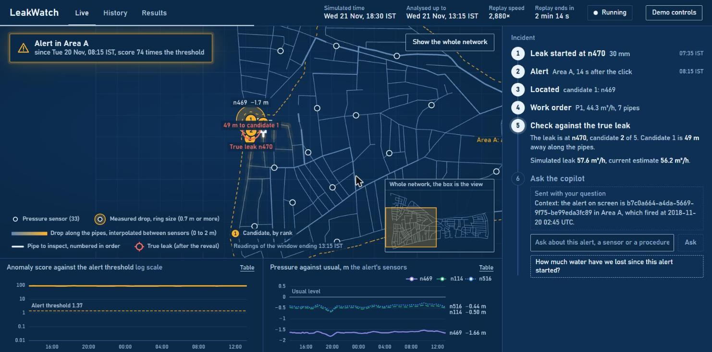

# LeakWatch

Software-only leak detection for water distribution networks, built and evaluated on the open
[BattLeDIM 2020](https://github.com/KIOS-Research/BattLeDIM) benchmark network L-Town (782
junctions, 905 pipes, 33 pressure sensors, two years of 5-minute SCADA data with 33 labelled leaks).

- **When** is something wrong? Sensor readings stream through Kafka into Spark Structured
  Streaming; K-Means (Spark MLlib) scores every 1-hour window against normal behaviour and raises
  alerts. The score combines the distance to the nearest normal cluster with what the kept
  principal components cannot explain, so a change in an unusual direction still counts. BDT title: *Applying K-Means Clustering for Anomaly Detection in Water Resource
  Management.*
- **Where** is the leak? A localizer trained on simulated leaks (MLP, GCN and GAT compared with a
  nearest-sensor baseline) ranks the 5 most likely junctions, so a crew starts with 5 junctions
  instead of 43 km of pipe (`network_stats.json`). An LSTM autoencoder is compared with K-Means as
  a second detector.
- **What do we do?** An operator copilot turns each alert into a work order (priority, pipes to
  inspect in order, estimated loss, manual citations) and answers questions with tools: read-only
  SQL on the lake, sensor charts, the localizer, a loss estimate, manual search and complaint
  intake. Every number it states must come from a tool result.

No hardware and no real utility data: "sensors" are the benchmark's recorded data or simulator
output replayed into Kafka. L-Town is a benchmark network, not a real city.

## Results

Every number below is generated by `make reports` from `reports/metrics/*.json`, and each metrics
file records the git commit of the code that produced it. Subject report drafts:
[BDT](reports/bdt/REPORT.md) · [DL](reports/dl/REPORT.md) · [PE](reports/pe/REPORT.md) ·
[ST](reports/st/REPORT.md).

<!-- results:start (generated by `make reports`; do not edit by hand) -->
| Result | Value | Source (`reports/metrics/`) |
|---|---|---|
| BattLeDIM SCADA | 12,509,280 readings per year (119 sensors, 5 min); 33 leaks, 23 active in 2019 | `data_summary.json` |
| Kafka replay throughput (2018) | 170,190 readings/s (target 10,000), 0 delivery errors | `replay_battledim_2018.json` |
| Batch = stream features | 0 of 16,327,708 cells differ | `features_parity_battledim.json` |
| Raw lake | 100,108,512 readings, 901.1 MB Parquet | `lake_layers_summary.json` |
| Batch features + K-Means scoring, largest scale | 100,108,512 readings in 4.1 min (404,676 readings/s, peak 4.35 GB) | `bdt_scaling.json` |
| K-Means 2019 (live model) | 19/19 leaks alerted within 7 days (chance level 97.7%), precision 0.364, 2.38 false alarms/week, median 20.8 h to detection | `bdt_kmeans_2019.json` |
| K-Means 2019 (all 228 features) | 19/19 leaks alerted within 7 days (chance level 99.6%), precision 0.437, 2.90 false alarms/week, median 18.1 h to detection | `bdt_kmeans_2019.json` |
| Simulated leaks on normal 2018 data, by detector | residual: 51.1% detected, 1.21 false alarms/week; residual_ci: 72.2% detected, 1.07 false alarms/week; rebaselined: 60.0% detected, 0.00 false alarms/week (180 leaks, 10–30 mm) | `bdt_synthetic_leaks.json` |
| Live alert (2019 replay at 360×) | 93.2 s wall from leak start to alert; same alert as the batch run: True | `bdt_live_replay_2019.json` |
| Best 2019 detection with ≤ 2 false alarms/week | LSTM-AE 100.0% (chance 95.2%); K-Means (all PRD features) 42.1% (chance 91.5%); K-Means (residual features) 68.4% (chance 98.8%); K-Means (residual, combined index) 36.8% (chance 90.5%); K-Means (re-baselined, combined index) 100.0% (chance 93.5%) | `dl_lstm_ae.json` |
| Localizer on held-out simulated leaks (gcn_sens_no_context) | top-5 21.1% (MLP 14.5%); medium + large leaks 30.4% (target 60%, MLP 20.2%); best of top 5 within 300 m 77.1% | `dl_gnn.json` |
| Localizer on the 2019 BattLeDIM leaks (19, network × sensor prior, D-042) | 36.8% within 300 m (best of 5: 42.1%); network alone 15.8%, most-dropped sensor 31.6%; gain over the network 21.1% (95% CI 5.3% to 42.1%) | `dl_gnn_prior.json` |
| System localizer, GLS inversion (D-044, chosen: gls_sim) | held-out simulated medium + large leaks top-5 69.4% (95% CI 64.6%–73.8%; target 60%); 2018 leaks within 300 m 35.7%; 2019 leaks within 300 m 26.3% (previous posterior 36.8%) | `dl_localizer.json` |
| Localizer on overlapping simulated leaks (2–8 new leaks at once, D-051) | top-1 within 300 m of a new leak: gls_sim 92.3%, previous posterior 75.0% (480 scenarios) | `dl_localizer_multileak.json` |
| Slow detectors for 10 mm leaks (night inflow, pressure CUSUM; D-048) | best 0.0% detected at 0 false alarms on 2018 normal data (night inflow spread 7.92 m³/h) | `bdt_slow_detectors.json` |
| BattLeDIM 2020 official score, 2019 (D-037) | €115,210: 10 of 23 leaks, 70 false positives; below the 6 tabulated teams (6th €127,626); random alert timing scores at least as well with p = 0.9602 | `battledim_score.json` |
| Detector timing with every report at the true leak, 2018 (D-047) | €169,673 vs random times €153,917 (p = 0.0100) | `battledim_score.json` |
| Detector timing with every report at the true leak, 2019 (D-047) | €500,484 vs random times €516,115 (p = 1.0000) | `battledim_score.json` |
| Mutation score, 6 core modules (D-040) | 88.1% of mutants killed (3,448 mutants of the scorer, detection metrics, re-baselining, alert rule, SQL guard and guardrails) | `st_mutation.json` |
| Copilot v3 (nvidia/nemotron-3-ultra-550b-a55b) | SQL execution 93.8%, answers 94.4%, hallucinated numbers after guardrail 0.0%, refusals 100.0%; data answers median 6.9 s (aim ≤ 10 s, free endpoint) | `pe_eval_v3.json` |
| Live scored stream at 360× (micro-batch time) | p50 7.0 s, p95 10.4 s (aim ≤ 10 s) | `bdt_live_replay_2019.json` |
| Demo rehearsal (inject → alert → top 5 → work order) | 5 of 5 runs within 30 s; slowest 28.9 s; nearest of the localizer's top 5 to the leak: n100 0 m / n300 0 m / n470 0 m / n100 0 m / n300 2,209 m (at the alert, before refinement: 0 m / 0 m / 0 m / 0 m / 2,209 m) | `demo_runs.json` |
| Tests | 843 passed, 0 failed; line coverage 73.9%, core modules 93.0% | `test_summary.json` |
<!-- results:end -->

What the numbers say, briefly (details and figures in the report drafts):

- 2019 never has a leak-free moment (on average 10.3 leaks flow at once, `data_summary.json`), and
  the share of windows above the K-Means threshold grows through the year. Any detector that alerts often will "catch" nearly
  every leak within 7 days, which is why the evaluation reports the chance level next to the
  detection rate; precision, false alarms per week and time to detection are the informative
  columns.
- The detector was chosen without looking at 2019: `make bdt-synthetic` adds simulated leaks of
  three sizes to normal late-2018 data and counts how many each variant catches and how many
  false alarms it raises. The combined score catches more of them with fewer false alarms than
  the cluster distance alone, so it is the live model. On 2019 it catches fewer leaks: its score
  is above the threshold most of the time there, so a new leak rarely opens a new alert.
- The localizer is trained on simulated single leaks. On held-out simulations the GAT ranks the
  leak in its top 5 more often than the MLP and the nearest-sensor heuristic, but below the 60%
  target for medium and large leaks. The ablation in the DL report shows which inputs matter.
  On the real 2019 data (many leaks at once, a model that differs from the real network) it is
  worse than the nearest-sensor heuristic; the report lists each leak.
- The copilot numbers name the model and endpoint they were measured with. A small local model
  on CPU is expected to score lower and answer more slowly than a hosted 70B-class model on a
  free endpoint; `make pe-eval` with another model's settings replaces the files.

## Architecture

```
 BattLeDIM CSV / simulator ──► replayer ──► Kafka ──► Spark Structured Streaming ──► Parquet lake
                                                              │   (raw → clean → features, exactly once)
                                     K-Means score + alert rule (same code batch and live)
                                                              │
                                 localizer top 5 ── alerts ── work orders (copilot)
                                                              │
                     DuckDB (read-only) ──► control-room screen (FastAPI, deck.gl, ECharts) + copilot
```

Details: [docs/architecture.md](docs/architecture.md). Every non-obvious choice and its reason:
[docs/DECISIONS.md](docs/DECISIONS.md).

## Quick start (Windows + WSL2 Ubuntu, or any Linux)

One-time toolchain inside WSL: `apt install openjdk-17-jdk-headless make docker.io
docker-compose-v2 build-essential`, then install [uv](https://docs.astral.sh/uv/). Copy
`.env.example` to `.env` and set `LEAKWATCH_DATA_DIR` to a folder on the WSL disk. Open a WSL
terminal in the repo folder and keep it open (WSL stops Docker when no terminal is attached).
From PowerShell, `cd` into the repo folder first and put `wsl` in front of each command
(`wsl make demo`); in any other folder, make answers `No rule to make target`.

```bash
make setup     # Python 3.11 venv with pinned dependencies (uv.lock, CPU-only PyTorch)
make data      # download BattLeDIM from Zenodo (MD5-checked), Parquet, leak ground truth
make up        # Kafka 4.3.2 (KRaft) in Docker + topics
make prepare   # replay 2018 + 2019 through Kafka, features, K-Means, alerts, localizer, RAG index
make demo      # live demo: control-room screen on http://localhost:8501
```

`make prepare` replays both years through Kafka and trains every model, so it takes a while; it
only needs to run once per data directory. `make help` lists every target.

### The demo



`make demo` starts the demo runner and the control-room screen on http://localhost:8501. The
runner replays a quiet week of BattLeDIM 2018 through Kafka into the live Spark stream at 2,880×
(one simulated hour every 1.25 seconds, about 3.5 minutes for the week).

1. Wait until the header says **Running**: 98 s after the start in the last rehearsal. The
   runner first loads the manual search and the network map for the work orders (about
   20 s), then Spark warms up the stream.
2. Click a junction on the map, or type one (for example `n470`) in step 1 on the right, and
   start a leak. EPANET simulates it and adds its pressure and flow signature to the readings.
   Until an alert comes, step 1 says how often the live detector caught each simulated leak size
   (8% of 10 mm, 72% of 20 mm, 100% of 30 mm leaks); **Demo controls** sets the size and speed.
3. When K-Means raises an alert, the banner turns amber, sensors whose pressure dropped get a
   ring, the area gets a dashed outline, and the map flies to the localizer's five candidates,
   numbered by rank. They are junctions to inspect, best first, not one answer: on the
   held-out benchmark the leak junction was among the five 69% of the time and candidate 1 lay a
   median 54 m from it, and the screen says so. When the alert came mostly from a flow meter
   (a leak behind a pressure-reducing valve, such as n300), step 3 notes that the localizer reads
   only the 33 pressure sensors.
4. The work order appears in step 4: the template version first, then the model's version.
5. **Reveal the true leak** zooms to the real junction and candidate 1, gives its rank and its
   distance along the pipes to candidate 1, and says which pipe of the work order ends at it.
6. Ask the copilot a question, or press the loss question, which is answered from the alert
   without a model. Questions outside LeakWatch (a poem, a capital city, sums, attempts to change
   its instructions) get one fixed refusal. The copilot works in UTC like the lake; the screen
   shows its times in IST, and times you type are read as IST.

The amber tint along the pipes is the only interpolated element on the map, and the legend says
so. Every number on the screen comes from the demo lake, the runner's state file or
`reports/metrics/`. The header shows how far the stream has analysed, which trails the replay
when the laptop is busy; at the end of the week the header says **Finishing** until the stream has
analysed the last readings. The **History** tab lists the batch alerts of 2018 and 2019; the
**Results** tab shows the results table below with its source files.

`make demo-stop` stops a demo left running. `make demo-check` runs the leak path five times
without a person and records the timings in `reports/metrics/demo_runs.json`. `make ui-check`
loads the screen in headless Chrome in four states. The earlier Streamlit page is still there as
`make dashboard-legacy`. Screenshots: [reports/figures/ui/](reports/figures/ui/).

Before the demo: `make up`, then `make demo` (it checks its prerequisites and names the command
for anything missing). Without an LLM configured, work orders are rendered from the same tool
outputs with a fixed template, labelled "template fallback".

### Copilot model (free)

Any OpenAI-compatible endpoint whose model can call tools, set in `.env`: `LLM_BASE_URL`,
`LLM_API_KEY`, `LLM_MODEL`, and for a rate-limited free tier `LLM_RPM` (requests per minute to
stay under). Nothing here needs a paid account; `.env.example` lists free options (NVIDIA API
catalog, Groq free plan) with their settings (D-035).

```bash
make llm-check    # one minute: tool calling + one end-to-end answer, prints the latency
make pe-eval      # all prompt versions; if the free quota runs out it stops, rerun to continue
make reports
```

Free tiers limit speed, not answer quality: the client paces its requests, waits out
"429 Too Many Requests" and the evaluation keeps every scored answer, so an interrupted run
continues where it stopped instead of counting the failure as a wrong answer.

Offline, without any account: a local CPU model (llama.cpp + Qwen3-4B-Instruct, 2.1 GB
download), slower and smaller:

```bash
make llm-local    # serves http://127.0.0.1:8080/v1 (leave it running)
LLM_BASE_URL=http://127.0.0.1:8080/v1 LLM_API_KEY=local LLM_MODEL=qwen3-4b-instruct-2507 \
  LEAKWATCH_CONFIG=configs/local_llm.yaml make pe-eval
```

## Main commands

| Command | What it does |
|---|---|
| `make test` / `make test-all` | unit + contract tests / also the slow ones (metamorphic, simulator oracle) |
| `make test-integration` | Kafka → Spark → lake end-to-end tests (needs `make up`) |
| `make test-report` | tests with coverage → `test_summary.json` |
| `make lint` / `make fmt` | ruff check / format |
| `make ingest-year YEAR=2018` | replay a year through Kafka into the raw lake with Spark alongside |
| `make features` / `make stream-features` | batch / live feature tables (same function) |
| `make features-parity` | live vs batch features, window by window |
| `make prepare` | fresh data directory → lake, features, models, alerts, localizer, work orders, RAG index |
| `make bdt-train` / `make bdt-eval` | K-Means variants on 2018 / evaluation on 2019, alerts into the lake |
| `make bdt-synthetic` | simulated leaks on normal 2018 data, one result per residual detector |
| `make live-replay` | replay part of 2019 at 360× with live scoring and alerts |
| `make sim-scale` / `make sim-ingest` | Spark-parallel scenario simulation / its replay through Kafka |
| `make bdt-scaling` | batch features + scoring at 12.5M, ~50M and 100M+ readings |
| `make lstm-ae` | LSTM autoencoder and the comparison with K-Means |
| `make gnn-data` / `make gnn` | localizer training data / nearest-sensor, MLP, GCN, GAT and ablations |
| `make gnn-apply` | re-localize the current alerts with the saved localizer (no retraining) |
| `make index` / `make dispatch` / `make pe-eval` | RAG index (the first build OCRs the scanned 1999 manual once) / work orders / copilot evaluation |
| `make llm-check` | check that the LLM in `.env` can call the copilot's tools (no metrics) |
| `make llm-local` | optional local CPU model for the copilot (2.1 GB download) |
| `make demo` / `make demo-check` | live demo / headless rehearsal |
| `make reports` | report drafts and the results table above |
| `make lake-stats` | rows, files and bytes per lake layer |

After `make bdt-eval` (it rewrites the batch alerts) run `make gnn-apply` and then
`make dispatch`. Full-scale runs use `LEAKWATCH_CONFIG=configs/full.yaml` (313 simulated weeks, 5,000 localizer
scenarios); the defaults are laptop-safe.

## Repository layout

```
configs/        default.yaml (laptop-safe) · full.yaml (full scale) · local_llm.yaml
docs/           architecture.md · DECISIONS.md · kb/ (copilot knowledge base)
src/leakwatch/  common/ data/ sim/ ingest/ stream/ features/ bdt/ dl/ copilot/ eval/ demo/ dashboard/
scripts/        thin shell entry points called by make
notebooks/      EDA only
tests/          unit/ contract/ metamorphic/ integration/
evals/          copilot question set (72 items)
reports/        metrics/*.json (source of truth) · figures/ · bdt/ dl/ pe/ st/ report drafts
```

## Data and sources

- BattLeDIM dataset: S. G. Vrachimis et al., "BattLeDIM: Battle of the Leakage Detection and
  Isolation Methods", Zenodo, doi:10.5281/zenodo.4017659; and S. G. Vrachimis et al., J. Water
  Resources Planning and Management 148(12), 2022.
- Simulation: [WNTR](https://github.com/USEPA/WNTR) and [epyt-flow](https://github.com/WaterFutures/EPyT-Flow) (EPANET).
- Copilot manuals: CPHEEO Manual on Operation and Maintenance of Water Supply Systems (2005) and
  CPHEEO Manual on Water Supply and Treatment (third edition, 1999; a scan, OCR'd by
  `make index`), public copies on India Water Portal; our own knowledge-base notes in `docs/kb/`.
